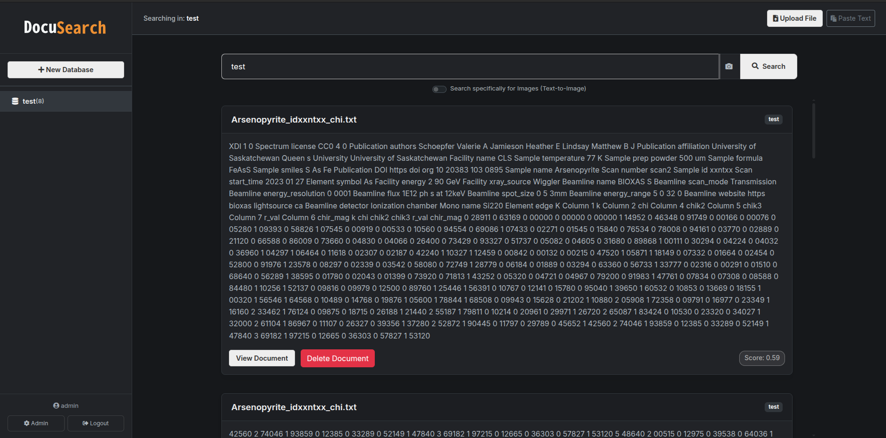
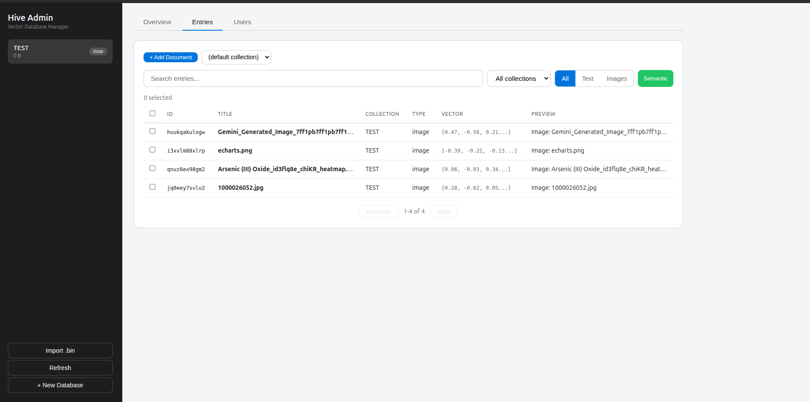

# Hive

**Hive** is a lightweight, file-based multimodal vector database and semantic search engine for Node.js. It stores, retrieves, and searches text and image documents using vector embeddings — no external services required.

## Features

- **Multimodal** — Store text and images in the same database
- **Semantic Search** — Text-to-text, text-to-image, and image-to-image similarity search
- **Auto-processing** — Automatically detects file types and generates embeddings
- **File support** — `.txt`, `.doc`, `.docx`, `.pdf` (text); `.png`, `.jpg`, `.jpeg` (images)
- **Binary persistence** — On-disk `.bin` with `msgpackr`-serialized for fast startup
- **Index cache** — Databases decode once into a read-only in-memory index for fast counts and search on large datasets
- **Batched import** — Chunk embeddings are generated in batches for faster bulk ingestion
- **Configurable chunking** — Configurable `SliceSize`, `overlap`, and `minSliceSize`
- **File watching** — Watch directories for changes with `chokidar`
- **Cross-encoder reranking** — Optional reranking pass for improved search quality
- **Per-database access control** — Granular read/readWrite permissions per database
- **Global user store** — Users persisted in `db/hive_users.json`, survive restarts
- **MCP Server** — Expose Hive as tools for AI agents (local stdio + remote SSE)
- **Custom models** — Plug in any `@xenova/transformers` compatible model

## Architecture

```
node admin.js        → Web UI + REST API + MCP remote SSE (port 3030)
node mcp.js          → Local MCP stdio (for AI assistants)
node scripts/import-folders.js  → Batch import docs/ → databases
node scripts/arxiv-bench.mjs    → Download an arXiv corpus and import it (performance testing)
```

## Quick Start

```bash
# From npm
npx @deonis/hive

# Or from source
git clone https://github.com/dspasyuk/hive.git
cd hive
npm install
node admin.js
```

Open `http://localhost:3030` — login with `admin` / `admin`. Set `PORT` to override the port.

## Web UI

The admin server provides two interfaces:

### Client Search UI (`/search`)
- Full-text and semantic search across databases
- Left sidebar with database tree selector
- Upload files, paste text, search by image
- Drag-and-drop file upload with progress
- Result highlighting and similarity scores
- Per-database access control (users see only their databases)

### Admin Panel (`/admin`)
- Database browser — view, create, drop databases
- Entry explorer — browse entries with type filtering, pagination
- Semantic search — multi-modal text and image search
- User management — create users, set root access, assign per-database read/readWrite permissions
- Entry preview — inspect metadata, content, vectors, images

### Login
- Default credentials: `admin` / `admin`
- Users are stored in `db/hive_users.json` (survives restarts)
- Root users see and manage all databases
- Regular users only see databases they have access to

## Per-Database Permissions

Instead of global roles, each user's access is defined per database:

| Access Level | Allows |
|---|---|
| `read` | Search and view documents |
| `readWrite` | Upload, edit, delete documents; manage other users' access |

Root users (role `root`) have full access to everything.

**Database owners** can manage access for their databases directly from the search sidebar — click the users icon next to a database you own.

## Import Folders

Batch-import documents from `docs/` and `img/` subdirectories as databases:

```
docs/MeetingNotes/meeting1.txt   → database "MeetingNotes"
docs/MeetingNotes/report.pdf
img/Screenshots/shot1.png        → database "Screenshots"
```

```bash
npm run import-folders
```

Each subdirectory becomes a database named after the folder. Top-level files in `docs/` go into the `Main` database.

## Open-Access Test Corpus (arXiv)

Generate a large, realistic test database from open-access arXiv papers:

```bash
# Abstracts only — fast, about 1 chunk per paper
node scripts/arxiv-bench.mjs --mode abstracts --count 1000 --db arxiv

# Full text — downloads PDFs and extracts text (about 20-40 chunks per paper)
node scripts/arxiv-bench.mjs --mode pdfs --count 1000 --db arxiv-pdfs
```

Options: `--query`, `--start`, `--page-size`, `--api-delay`, `--dl-delay`, `--min-slice`, `--dry-run`, `--no-import`.
Downloads are resumable and rate-limited; documents are stored under `docs/<db>/`.

## Performance & Large Databases

- Databases decode on demand into a read-only **index** (metadata + Float32 vectors), cached by file path and invalidated when the file changes. Counts and search do not re-read the whole `.bin` on every request.
- Vector search is brute-force cosine with a bounded top-K heap — roughly linear in the number of vectors (about 70-80 ms per 100k 768-dim vectors).
- Set `HIVE_INDEX_CACHE_BYTES` (default 1 GiB) to bound total index memory.
- Import embeddings are batched (`Hive.embedBatchSize`, default 32), and PDF image/metadata extraction is skipped for text-only indexing.
- Past roughly 100k vectors per database, an approximate (ANN) index is the next step.

## Testing

```bash
npm test
```

Runs the unit/integration suites: vector round-trip, batched chunking, search, folder import, and index cache/scan.

## API

| Method | Description |
|--------|-------------|
| `Hive.init(options)` | Initialize the database |
| `Hive.embed(input, type)` | Generate a vector embedding |
| `Hive.find(query, topK)` | Vector similarity search |
| `Hive.addFile(filePath)` | Add a file (auto-detects text/image) |
| `Hive.removeFile(filePath)` | Remove file entries |
| `Hive.insertOne(entry)` | Insert a document |
| `Hive.insertMany(entries)` | Bulk insert |
| `Hive.deleteOne(id)` | Delete by ID |
| `Hive.updateOne(query, entry)` | Update a document |
| `Hive.buildIndex(binPath, collection?)` | Decode a `.bin` into a read-only index |
| `Hive.getIndex(binPath, collection?)` | Cached index for a `.bin` file (mtime/size invalidated) |
| `Hive.searchVector(index, queryVector, topK)` | Cosine search over an index |
| `Hive.invalidateIndex(binPath)` | Drop a cached index (call after writing a DB) |

### `Hive.init(options)`

| Option | Default | Description |
|--------|---------|-------------|
| `dbName` | `"Documents"` | Database name |
| `storageDir` | `process.cwd()` | Directory for the database folder |
| `pathToDB` | — | Full path to `.bin` file (overrides `storageDir`) |
| `pathToDocs` | `false` | Directory to auto-import documents from |
| `watch` | `false` | Watch directory for changes |
| `logging` | `false` | Enable processing logs |
| `SliceSize` | `512` | Token limit per chunk |
| `minSliceSize` | `100` | Minimum tokens to index a chunk |
| `overlap` | `5%` of `SliceSize` | Chunk overlap (percentage < 1 or token count >= 1) |
| `rerank` | `false` | Enable cross-encoder reranking |
| `models` | — | Override embedding models (`{ text, image, rerank }`) |

## MCP Server

Hive exposes its search and ingestion capabilities as MCP tools for AI agents (Claude, opencode, etc).

### Local stdio (for AI assistants on the same machine)

```bash
npm run mcp
```

MCP client config:

```json
{
  "mcpServers": {
    "hive": {
      "command": "node",
      "args": ["/path/to/hive/mcp.js"]
    }
  }
}
```

Tools: `hive_init`, `hive_find`, `hive_add_file`, `hive_embed`

### Remote SSE (built into admin server)

The admin server includes an MCP SSE endpoint at `http://host:3030/mcp/sse` — no extra process needed.

MCP client config:

```json
{
  "mcpServers": {
    "hive": {
      "url": "http://your-server:3030/mcp/sse"
    }
  }
}
```

Remote tools require `username` and `password` parameters (validated against `hive_users.json`):

- `hive_find` — search a database (checks read access)
- `hive_add_file` — upload a file (checks write access)
- `hive_auth` — verify credentials and list accessible databases

### opencode Configuration

```json
{
  "mcp": {
    "hive": {
      "type": "local",
      "command": ["node", "/path/to/hive/mcp.js"],
      "enabled": true
    }
  }
}
```

## Screenshots

### Client Search UI


### Admin Web UI


## License

MIT
